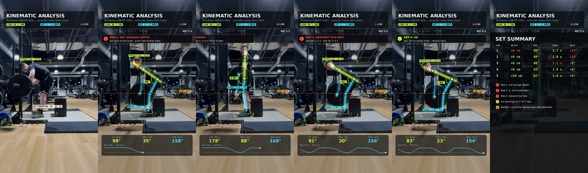
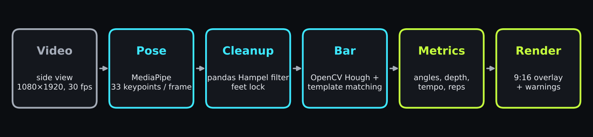
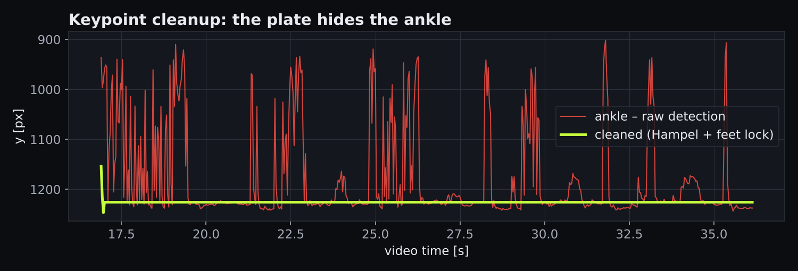
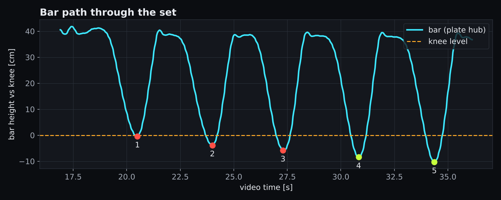
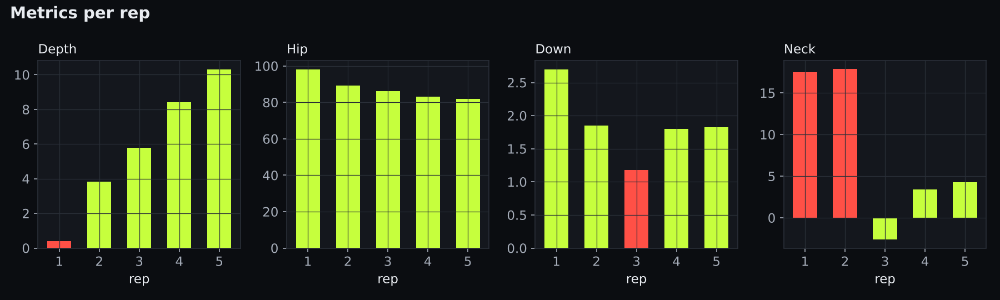
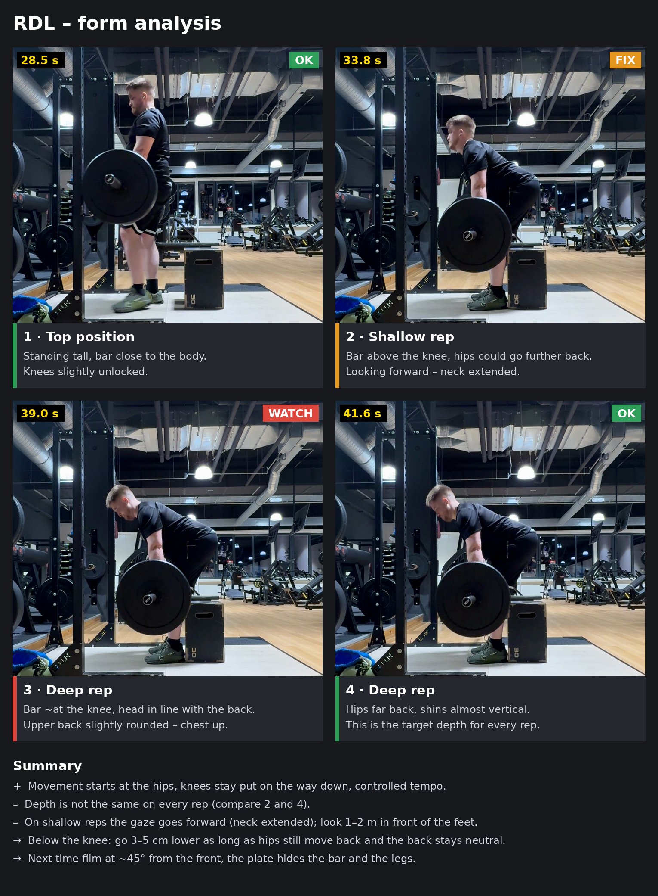

# lift-form-check

Computer vision form check for barbell lifts from a single phone video.
Pose estimation + bar tracking → joint angles, depth, tempo and per-rep warnings,
rendered as a 9:16 video ready for an Instagram story or reel.

Supported: **RDL**, **deadlift**, **back squat** and a `generic` mode (angles only).
New exercises are added in [`exercises.yaml`](lift_form_check/exercises.yaml), no code needed.



## How it works



1. **Pose**: MediaPipe Pose Landmarker (heavy), 33 keypoints per frame.
2. **Cleanup**: the plates hide knees and ankles, so the raw detection jumps around a lot.
   A Hampel filter (pandas rolling median) removes outliers, Savitzky-Golay (SciPy) smooths,
   feet are locked once the set starts and for RDL the knees are limited to a small range.
3. **Bar**: OpenCV Hough circles find the plate once (the circle closest to the hands),
   then `cv2.matchTemplate` follows the plate hub. The 45 cm plate is used to convert px → cm.
4. **Metrics**: hip / knee angle, torso lean, neck vs back line, reps from bar height peaks
   (`scipy.signal.find_peaks`), depth vs knee level, descent time.
5. **Render**: supervision annotators for the keypoint mesh and detection boxes, OpenCV for
   the glowing skeleton and bar path, Pillow for the HUD. Written with imageio-ffmpeg.



## Example output (RDL, 5 reps)




Still frame analysis:



## Warnings

Only measured values, per exercise (thresholds live in `exercises.yaml`):

| Exercise | Warning | Rule |
|---|---|---|
| RDL | not enough depth | bar < 1.5 cm below knee level |
| RDL | descent too fast | < 1.5 s |
| Squat | above parallel | hip above knee at the bottom |
| Squat | uncontrolled descent | < 1.0 s |
| Deadlift | soft lockout | hip angle at the top < 165° |
| Deadlift | hips shoot up | hips rise > 1.6× faster than the bar in the first 40 % of the pull |
| all | neck extended | head > 12° above the back line at the bottom |

## Usage

```bash
pip install -r requirements.txt      # needs ffmpeg
python -m lift_form_check lift.mp4 out.mp4 --exercise rdl --start 17 --load "90 % 1RM"
```

| option | |
|---|---|
| `--exercise` | `rdl`, `deadlift`, `squat`, `generic` |
| `--start` | second when the feet are set (bar out of the rack) |
| `--load` | text for the header, e.g. `"120 kg"` |
| `--slow` | if the set part is slowed down (e.g. `0.75`), tempo is still reported in real seconds |
| `--strap FROM TO` | show a "sped up" label between two seconds |
| `--lang` | on-screen text, `en` (default) or `sl` |

The pose model is downloaded on the first run. Pose results are cached next to the video
(`*_pose.json`), per-rep numbers are saved to `*_reps.json` and printed as a table.

Charts: `python scripts/make_figures.py lift.mp4 --exercise rdl --start 17`.

### Project layout

```
lift_form_check/
  cli.py          command line, ties everything together
  pose.py         MediaPipe keypoints (+ cache)
  bar.py          plate detection and hub tracking
  cleanup.py      outlier removal and smoothing
  metrics.py      angles, reps, per-rep numbers
  exercises.yaml  exercise profiles and warning rules
  exercises.py    loads the profiles, checks the rules
  overlay.py      skeleton, bar path, boxes on the video
  hud.py          header, live stats, warnings, summary
  draw.py         small drawing helpers
  video.py        read / write video
  i18n.py         English / Slovenian text
scripts/make_figures.py
```

### Filming tips
- side view, camera at hip height, ~3 m away, whole body and plate in frame
- vertical video, 30 fps
- the left side of the body should face the camera

## Libraries

[MediaPipe](https://github.com/google-ai-edge/mediapipe) ·
[OpenCV](https://opencv.org) ·
[supervision](https://github.com/roboflow/supervision) ·
[NumPy](https://numpy.org) · [SciPy](https://scipy.org) · [pandas](https://pandas.pydata.org) ·
[Pillow](https://python-pillow.org) · [imageio-ffmpeg](https://github.com/imageio/imageio-ffmpeg) ·
[PyYAML](https://pyyaml.org) · [tqdm](https://github.com/tqdm/tqdm) · [rich](https://github.com/Textualize/rich) ·
[Matplotlib](https://matplotlib.org)

## Limitations

- 2D only. Angles depend on the camera being perpendicular to the lifter.
- Knees and ankles are behind the plate, so depth is an estimate within a few cm.
- MediaPipe keypoints are not anatomical landmarks (hip ≠ greater trochanter).
- Squat and deadlift rules are simple heuristics and less tested than RDL.

## Author

Žiga Komac
